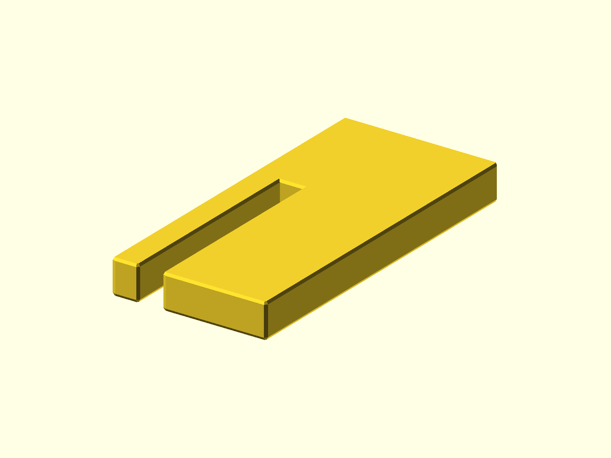

# Bandsaw Table Inserts for the Rikon 10-306 and WEN 3939

Table insert plates for the Rikon 10-306 and WEN 3939 bandsaws. Both inserts are
treated equally; the WEN plate is the primary preview because it has the most
test use.



## Status

- Last verified: 2026-10-22 (build)
- OpenSCAD version: see the [root README](../../README.md)
- Physically tested: yes; the WEN plate has more test use

## Files

| File | Purpose |
|---|---|
| `rikon_10_306_table_insert.scad` | Rikon 10-306 insert |
| `wen_3939_table_insert.scad` | WEN 3939 insert |
| `render.json` | primary WEN and Rikon variant |

## Variants

| Variant | Image | Content |
|---|---|---|
| primary | `img/primary/` | WEN 3939 insert |
| `rikon` | `img/rikon/` | Rikon 10-306 insert |

Both inserts are supported, not a ranked primary/variant pair.

## Dimensions

- Rikon 10-306: 60.2 mm diameter, 3 mm plate; the eight locating tabs
  bring it to 3.6 mm as printed. File the tabs for a flush fit on your
  saw — bed castings vary. 1.8 x 35 mm blade slot; tabs offset 22.5
  degrees.
- WEN 3939: about 26 x 56 x 6 mm as printed (25 x 55 x 5 mm before the
  edge rounding); 5 x 35 mm slot.

## Hardware

None.

## Fit notes

Both inserts have been tested. Machine-bed castings vary, so the inserts may
need hand filing or light fitting to sit flush — adjust the tab heights
and edges to your machine

## Material

PETG or another strong material is recommended. The insert sits in the blade
path; check the fit and slot edges before use.

## Printing

Print flat as oriented. No supports are modeled.

## Build

```bash
python scripts/check_models.py --model bandsaw-table-inserts
python scripts/render_previews.py models/bandsaw-table-inserts --all
```

## Known issues

- Not yet published on Printables.
- Machine-bed casting variation may require filing or a light test fit.

## License

CC BY 4.0 — WolfOne (@wolfone_17684). See the repository [LICENSE](../../LICENSE).
