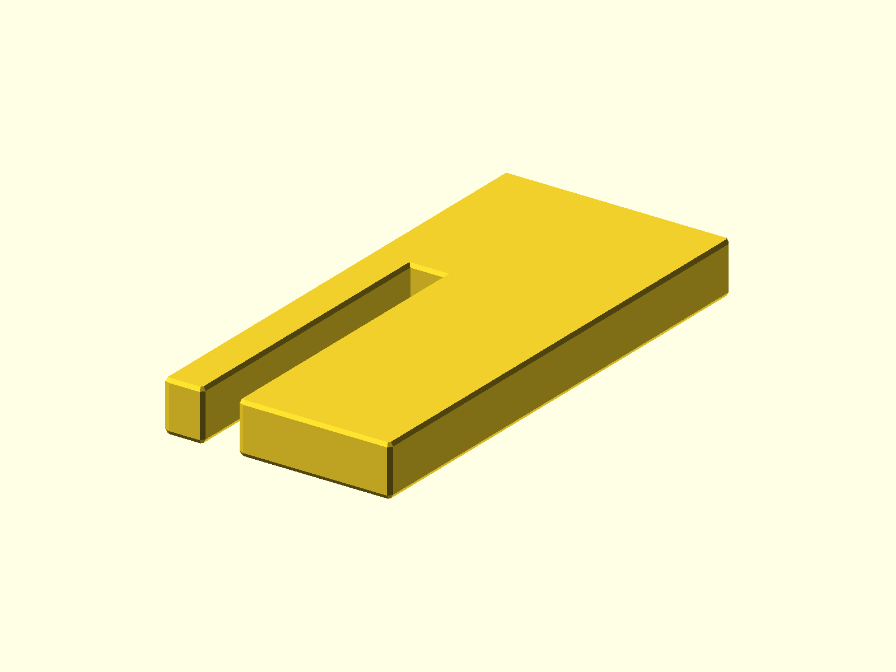

# Bandsaw Table Inserts

Table insert plates for the Rikon 10-306 and WEN 3939 bandsaws. Both inserts are
treated equally; the WEN plate is the primary preview because it has the most
test use.



## Status

- Last verified: 2026-10-22 (build)
- OpenSCAD version: see the [root README](../../README.md)
- Physically tested: yes; WEN plate is better tested (printer/date not recorded)

## Files

| File | Purpose |
|---|---|
| `rikon_10_306_table_insert.scad` | Rikon 10-306 insert |
| `wen_3939_table_insert.scad` | WEN 3939 insert |
| `render.json` | primary WEN and Rikon variant |

## Variants

| Variant | Image | Content |
|---|---|---|
| primary | `img/primary/` | WEN 3939 insert |
| `rikon` | `img/rikon/` | Rikon 10-306 insert |

Both inserts are supported, not a ranked primary/variant pair.

## Fit notes

Both inserts have been tested. Machine-bed castings vary, so the inserts may
need hand filing or light fitting to sit flush. The source comments keep the
per-saw fit notes; adjust the tab heights and edges to your machine. Because
they are printed, they are inexpensive to replace if the fit is not right.

## Material

PETG or another strong material is recommended. The insert sits in the blade
path; check the fit and slot edges before use.

## Printing

Print flat as oriented. No supports are modeled.

## Build

```bash
python scripts/check_models.py --model bandsaw-table-inserts
python scripts/render_previews.py models/bandsaw-table-inserts --all
```

Or directly:

```bash
openscad --hardwarnings -o build/wen_table_insert.stl wen_3939_table_insert.scad
```

## Known issues

- Not yet published on Printables.
- Machine-bed casting variation may require filing or a light test fit.

## License

CC BY 4.0 — WolfOne (@wolfone_17684). See the repository [LICENSE](../../LICENSE).
