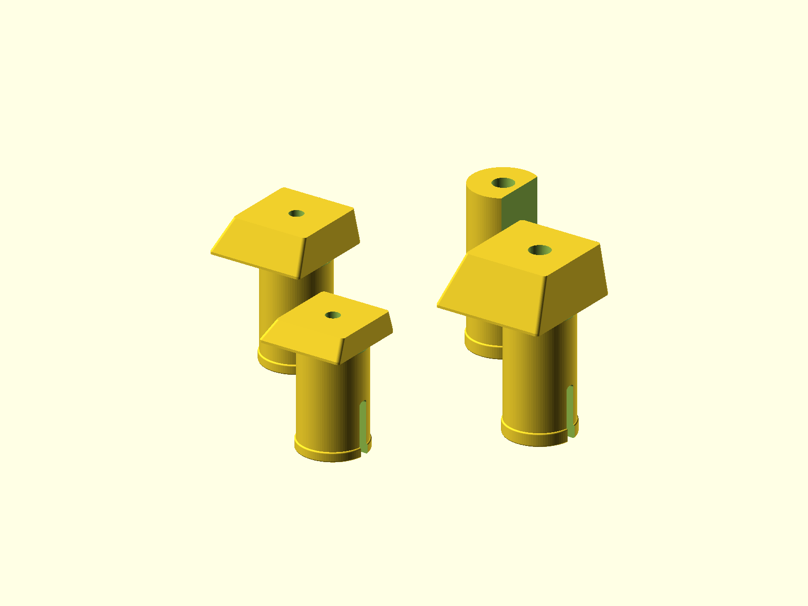

# Bench Dogs

Workbench dogs sized for 19 mm / 3/4 in holes. The file contains one A-style dog
and three B-style dogs: small, medium, and large.



## Status

- Last verified: 2026-10-22 (build)
- OpenSCAD version: see the [root README](../../README.md)
- Physically tested on: not recorded

## Design notes

- The center hole lets a screw sink in and hold the dog more securely.
- Without a screw, the dogs can be used as sacrificial dogs for planers and
  routers.
- Print at high density for strength. These parts take side loads at the head.
- The notch and screw-slot corners are rounded. Sharp internal corners are
  stress points.
- Each stem has a torus-relieved collar at its base. The collar adds material
  at the stem-to-base edge, then a donut-shaped cutter leaves a 1.5 mm fillet.

The A-style has a large side notch. The B-style sizes are:
small 1/4 in, medium 1/2 in, and large 3/4 in.

## Printing

Print upright as oriented. Use enough walls/infill for a stiff dog; the head is
the loaded end. No supports are modeled.

## Build

```bash
python scripts/check_models.py --model bench-dogs
python scripts/render_previews.py models/bench-dogs
```

Or directly:

```bash
openscad --hardwarnings -o build/bench_dogs.stl bench_dogs.scad
```

## Known issues

- Not yet published on Printables.
- Physical-test status is not recorded.

## License

CC BY 4.0 — WolfOne (@wolfone_17684). See the repository [LICENSE](../../LICENSE).
