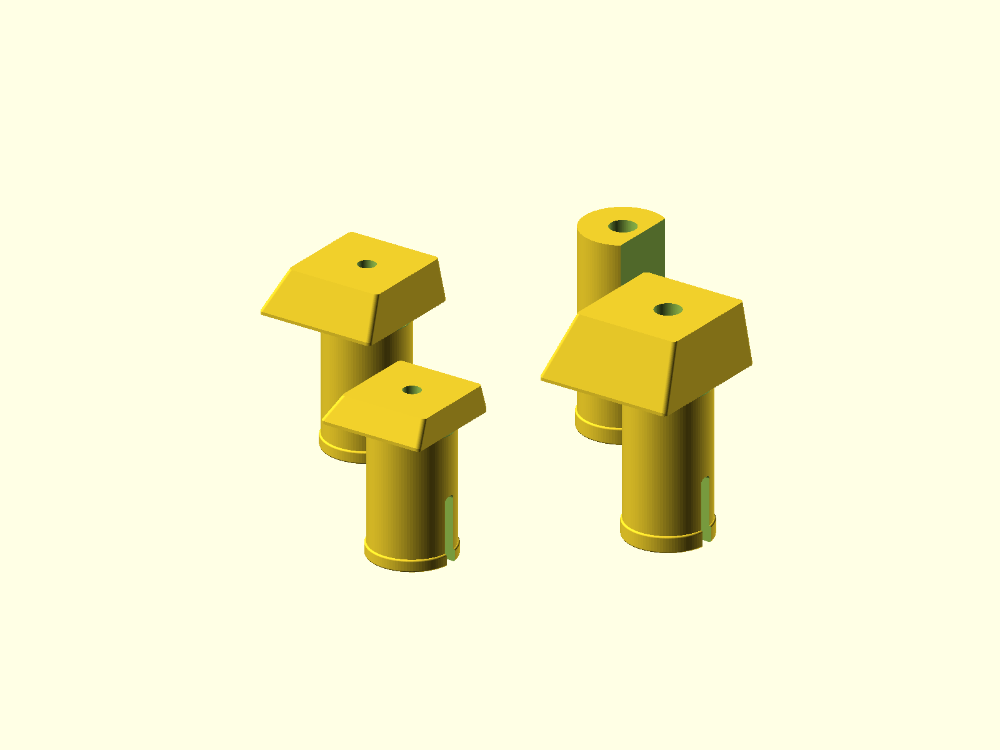

# Bench Dogs

Workbench dogs sized for 19 mm / 3/4 in holes. The file contains one A-style dog
and three B-style dogs: small, medium, and large.



## Status

- Last verified: 2026-10-22 (build)
- OpenSCAD version: see the [root README](../../README.md)

## Design notes

- The center hole lets you re-inforce with a screw or small metal rod. I personally sank a 4" screw through a small piece of wood and use that to pull them out of the bench.
- Without a screw, the dogs can be used as sacrificial dogs for planers and
  routers.
- Print at highish density for strength.
- The notch and screw-slot corners are rounded. Sharp internal corners are
  stress points.

The A-style has a large side notch. The B-style sizes are:
small 1/4 in, medium 1/2 in, and large 3/4 in.

## Dimensions

| Dog | Height | Head |
|---|---:|---|
| A | 45 mm (51 mm overall) | 19 mm stem with a side notch and a slightly flared base |
| B small | 30 mm | 23 mm |
| B medium | 30 mm | 26 mm |
| B large | 35 mm | 30 mm |

All stems are 19 mm (3/4 in) and slip into a standard bench dog hole. The
center screw slot is 3 mm wide by 15 mm tall.

## Hardware

One drywall screw per dog (optional) through the 3 mm center for rigidity, can adjust size for whatever screws. Also the feature is there to force additional inner walls for strength when printing.

## Material

PLA. PETG is an option for heavier bench use.

## Printing

Print upright as oriented. Use enough walls/infill for a stiff dog; the head is
the loaded end. No supports are modeled.

## Build

```bash
python scripts/check_models.py --model bench-dogs
python scripts/render_previews.py models/bench-dogs --all
```

## Known issues

- Not yet published on Printables.

## License

CC BY 4.0 — WolfOne (@wolfone_17684). See the repository [LICENSE](../../LICENSE).
