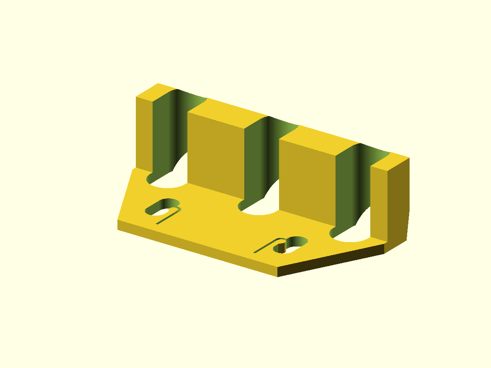

# Cable Organizer

Under-desk cable organizer with three cable slots and screw-mounting holes.



## Status

- Last verified: 2026-10-22 (build)
- OpenSCAD version: see the [root README](../../README.md)
- Physically tested on: Original Prusa MK3.5S

## Files

| File | Purpose |
|---|---|
| `cable_organizer.scad` | three-slot cable organizer |
| `render.json` | primary entry point |

## Dimensions

- Body: 55 x 30 x 16 mm.
- Three cable slots, 7.6 x 13.4 mm, on 20 mm centers. Cables must fit the slot
  width; the slots are open at the top and bottom.
- Two mounting holes, 2.6 mm diameter, 32.6 mm apart, with a 4 mm clearance slot.
- Mounting plate: 20 mm long, 55 mm wide tapering to 35 mm.

## Installation

Mount under the desk with two flat-head Phillips screws. The screw size is not
specified; check the 2.6 mm holes against your screws. Feed the cables into the
slots before mounting. Once the organizer is screwed to the underside, the desk
closes the open side and the cables cannot slide out. Changing cables requires
removing the organizer.

## Hardware

| Item | Qty | Notes |
|---|---|---|
| Flat-head Phillips screw | 2 | Size not specified; must fit the 2.6 mm mounting holes. |

## Material

Any common 3D-print filament.

## Printing

Print flat as oriented. No supports are modeled.

## Build

```bash
python scripts/check_models.py --model cable-organizer
python scripts/render_previews.py models/cable-organizer
```

Or directly:

```bash
openscad --hardwarnings -o build/cable_organizer.stl cable_organizer.scad
```

## Known issues

- Not yet published on Printables.
- The current design has no quick-release; cable changes require removing the
  organizer.

## License

CC BY 4.0 — WolfOne (@wolfone_17684). See the repository [LICENSE](../../LICENSE).
