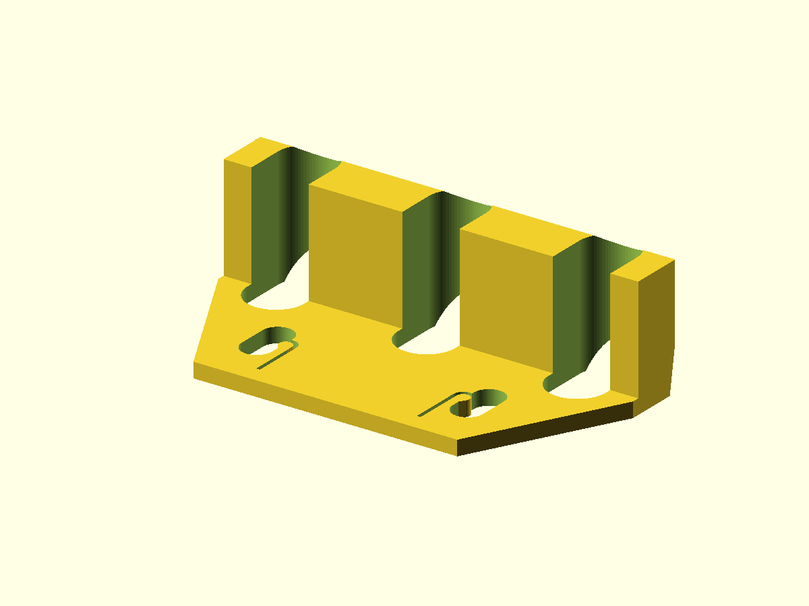

# Cable Organizer

Under-desk cable organizer with three cable slots and screw-mounting holes.



## Status

- Last verified: 2026-10-22 (build)
- OpenSCAD version: see the [root README](../../README.md)
- Physically tested on: Original Prusa MK3.5S

## Files

| File | Purpose |
|---|---|
| `cable_organizer.scad` | three-slot cable organizer |
| `render.json` | primary entry point |

## Dimensions

- Body: 55 x 30 x 16 mm.
- Three cable slots, 7.6 x 13.4 mm, on 20 mm centers. Cables must fit the slot
  width; the slots are open at the top and bottom.
- Two mounting holes, 2.6 mm diameter, 32.6 mm apart, with a 4 mm clearance slot.
- Mounting plate: 20 mm long, 55 mm wide tapering to 35 mm.

## Hardware

| Item | Qty | Notes |
|---|---|---|
| Flat-head Phillips screw | 2 | Size not specified; must fit the 2.6 mm mounting holes. |

## Installation

Mount under the desk with two flat-head screws. Feed the cables into the
slots before mounting. Changing cables requires removing the organizer. I do plan to revise this and come up with something more elegant eventually but it's a quick functional print.

## Material

Any common 3D-print filament.

## Printing

Print flat as oriented. No supports are modeled.

## Build

```bash
python scripts/check_models.py --model cable-organizer
python scripts/render_previews.py models/cable-organizer --all
```

## Known issues

- Not yet published on Printables.
- The current design has no quick-release.

## License

CC BY 4.0 — WolfOne (@wolfone_17684). See the repository [LICENSE](../../LICENSE).
