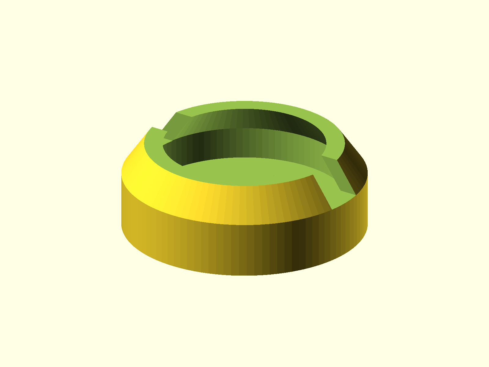

# Clamp Pads

Soft pads for bar clamps and C-clamps, intended for TPU. The group contains a
round swivel pad and a shaped top pad.



## Status

- Last verified: 2026-10-22 (build)
- OpenSCAD version: see the [root README](../../README.md)

## Files

| File | Purpose |
|---|---|
| `bar_clamp_swivel.scad` | round swivel pad; also usable on C-clamps |
| `bar_clamp_top.scad` | shaped top pad |
| `render.json` | primary and top-pad variant |

## Variants

| Variant | Image | Content |
|---|---|---|
| primary | `img/primary/` | bar-clamp swivel pad |
| `bar_top` | `img/bar_top/` | shaped top pad |

## Resizing

The swivel source is dimensioned in millimeters. Edit these six values for a
different bar or clamp:

```scad
wallThickness
diameter
footHeight
footThickness
slotWidth
bootAngle
```

Reference sizes:

| Clamp | `wallThickness` | `diameter` | `footHeight` | `footThickness` | `slotWidth` | `bootAngle` |
|---|---:|---:|---:|---:|---:|---:|
| 4 in C-clamp | 2 | 16 | 2.5 | 2 | 2 | 45 |
| 10 in C-clamp | 2.5 | 30.5 | 4 | 2.5 | 5.5 | 45 |
| Bar clamp default | 2 | 22.5 | 3.5 | 2.5 | 4.5 | 55 |

The swivel shape is not bar-specific. The same part can be used on a C-clamp
by resizing the diameter and foot dimensions to the clamp's cup.

The top pad is resized through its own dimensions: `totalWidth`,
`cylinderOffset`, `wallThickness`, `topWallThickness`, `footHeight`, and
`baseThickness`.

## Printing

Both parts are intended for TPU. Print them in the orientation shown and test
the fit before printing a full set. No supports are modeled.

## Build

```bash
python scripts/check_models.py --model clamp-pads
python scripts/render_previews.py models/clamp-pads --all
```

Or directly:

```bash
openscad --hardwarnings -o build/bar_clamp_swivel.stl bar_clamp_swivel.scad
```

## Known issues

- Not yet published on Printables.

## License

CC BY 4.0 — WolfOne (@wolfone_17684). See the repository [LICENSE](../../LICENSE).
