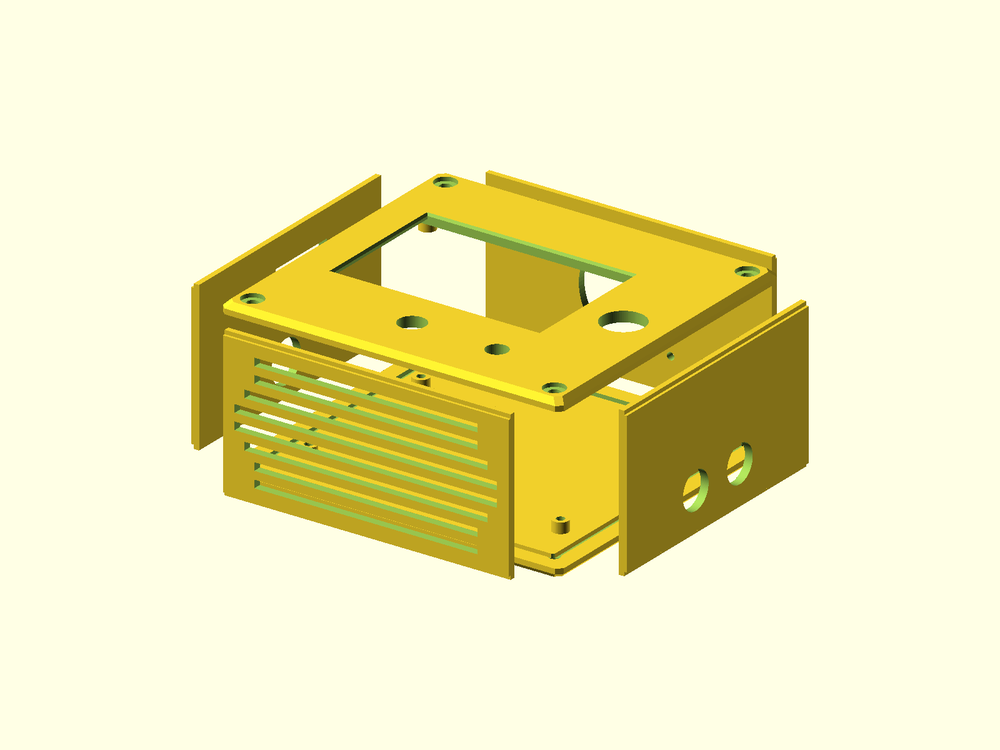
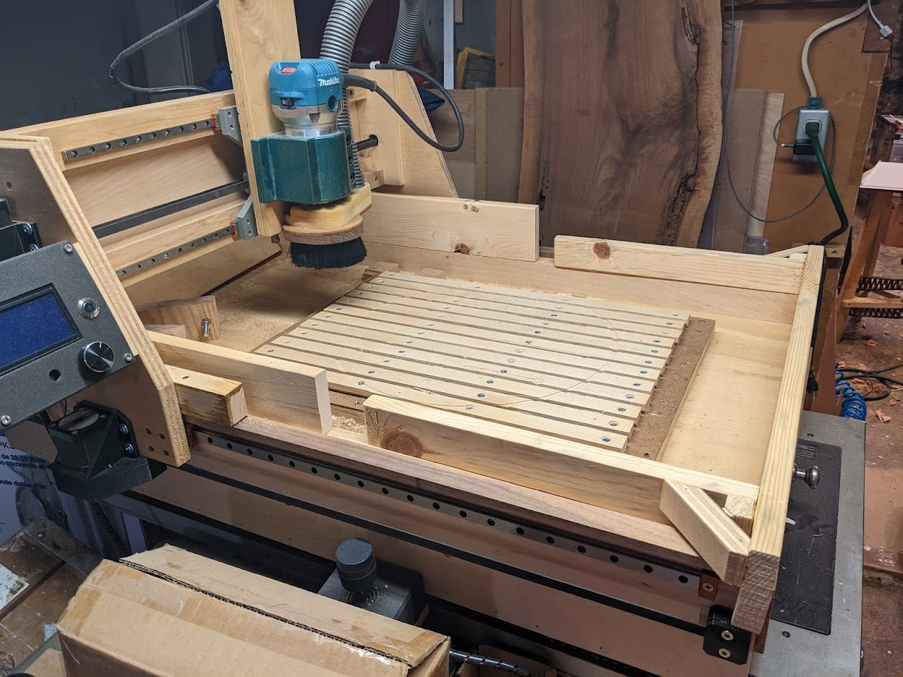
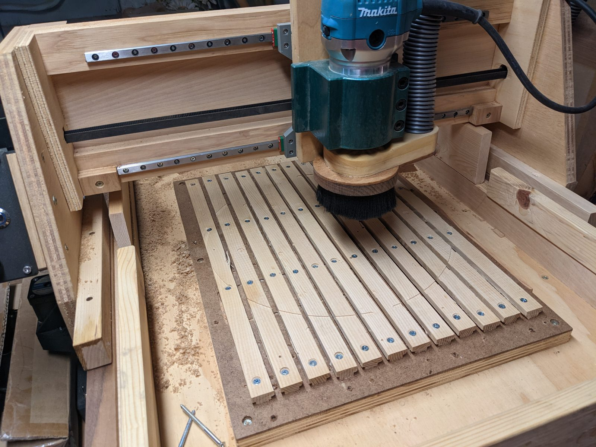
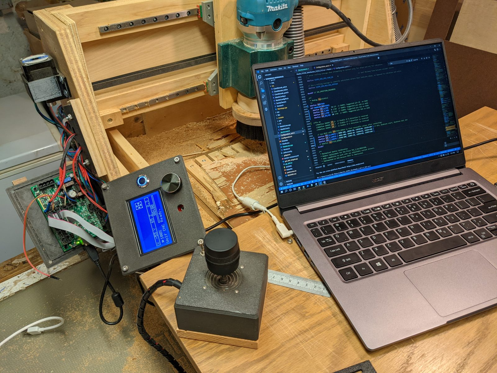

# CNC Machine Parts

Printed parts for a home-built plywood and hickory CNC router. The set contains
one electronics panel/joystick group and five mechanical part groups.



## Photos







## Status

- Last verified: 2026-10-24 (build)
- OpenSCAD version: see the [root README](../../README.md)
- Physically tested: yes, on a home-built CNC router; joystick case printed and tested
- Printables: not yet published

## Files

| File | Purpose |
|---|---|
| `electronics_box.scad` | Six enclosure panels plus the separate joystick box |
| `x_tensioner.scad` | Two-piece X-axis belt tensioner |
| `x_clamp.scad` | X-axis belt clamp with 15 mm belt slot |
| `y_plate.scad` | Y-axis plate with MGN rail and lead-screw cutouts |
| `z_mount.scad` | Z-axis T8 lead-screw, 608 bearing, and NEMA17 mount |
| `belt_plate.scad` | Belt plate, clamp blocks, and NEMA17 mount |
| `render.json` | Primary and part variants |

## Electronics enclosure

The enclosure is a **panel set**, not a single printed box. The six panels are
laid out together in `part = "panels"` and can be exported separately with the
`part` selector.

| Part | Size | Notes |
|---|---|---|
| Front and back | 130 × 120 mm | 4 mm panel; front has the display opening |
| Top and bottom | 109 × 57 mm | 3 mm panel; top has the fan opening |
| Left and right | 57 × 99 mm | 3 mm panel; cutouts differ |
| Joystick box | 84 × 84 × 40 mm | Separate box, connected by cable; JH-D300X-R3 joystick |
| Full print layout | 166 × 146 × 62 mm | All six panels together |

Cutouts:

- Front display: **79 × 52 mm**
- Rear controller: **96 × 61.2 mm**
- Top fan: **38 mm bore, 32 mm mounting centres** (40 mm fan)
- Joystick: **38.5 mm bore**, 32.5 × 32.5 mm mounting pattern

Export one part at a time:

```bash
openscad -D 'part="panels"'   -o build/electronics_panels.stl   electronics_box.scad
openscad -D 'part="front"'    -o build/electronics_front.stl    electronics_box.scad
openscad -D 'part="back"'     -o build/electronics_back.stl     electronics_box.scad
openscad -D 'part="top"'      -o build/electronics_top.stl      electronics_box.scad
openscad -D 'part="bottom"'   -o build/electronics_bottom.stl   electronics_box.scad
openscad -D 'part="left"'     -o build/electronics_left.stl     electronics_box.scad
openscad -D 'part="right"'    -o build/electronics_right.stl    electronics_box.scad
openscad -D 'part="joystick"' -o build/electronics_joystick.stl electronics_box.scad
```

## Mechanical parts

| Variant | Image | Description |
|---|---|---|
| `x-tensioner` | `img/x-tensioner/` | Two-piece X belt tensioner, 60 × 25 mm; clamp body and lid with mounting holes. |
| `x-clamp` | `img/x-clamp/` | X belt clamp, 30 × 24 × 9 mm, toothed 16 mm slot and hex-nut pockets. |
| `y-plate` | `img/y-plate/` | Y plate, 130 × 162.5 × 20.5 mm; MGN12 rail pattern, 8.45 mm lead-screw bore, Z-rail mounting. |
| `z-mount` | `img/z-mount/` | Z mount, 75 × 59.3 × 35 mm; T8 lead-screw bore, 608 bearing seat, NEMA17 pattern. |
| `belt-plate` | `img/belt-plate/` | Belt plate and clamp blocks, 30 × 104 × 23 mm; NEMA17 pattern and 16 mm belt slots. |

## Hardware

| Item | Use |
|---|---|
| 2× MGN12 rail, 4 slides | X axis |
| 2× MGN12 rail, 4 slides | Y axis |
| 2× MGN9 rail, 4 slides | Z axis |
| 15 mm belt and pulleys | X/Y drive |
| 5/16 in bolt + 1/2 in hex nut | X tensioner |
| T8 2 mm-pitch lead screw, nut, coupler, 608 bearing | Z drive |
| 40 mm fan, 4× M3 screws | Top electronics panel |
| JH-D300X-R3 10K 220° 3-axis joystick | Joystick box |
| 79 × 52 mm display | Front panel |
| 96 × 61.2 mm controller | Rear panel |
| M3 and M4 screws | Rails, panels, and part mounting |

Exact screw lengths depend on the build. The rail patterns use 3.1 mm pilot
holes with 6 mm counterbores; the front/back panel corners use 4.2 mm clearance
holes. The Z mount uses M4 hex-nut pockets and an M3 bearing retainer.

## Printing

Print the panels flat. The joystick is a hollow box with an open bottom; print it
open-side down. PETG was used for the machine parts. Filing may be needed on rail
and part fits. No supports are modeled.

The belt slots are 16 mm wide for 15 mm belts (1 mm clearance).

## Build

```bash
python scripts/check_models.py --model cnc-machine-parts
python scripts/render_previews.py models/cnc-machine-parts --all
```

Or directly:

```bash
openscad --hardwarnings -o build/electronics_box.stl electronics_box.scad
```

## Known issues

- The panel set is sized for the documented router; check dimensions before
  adapting it to another machine.
- Exact fastener lengths depend on the build.
- Joystick case printed and tested.

## License

CC BY 4.0 — WolfOne (@wolfone_17684). See the repository [LICENSE](../../LICENSE).
