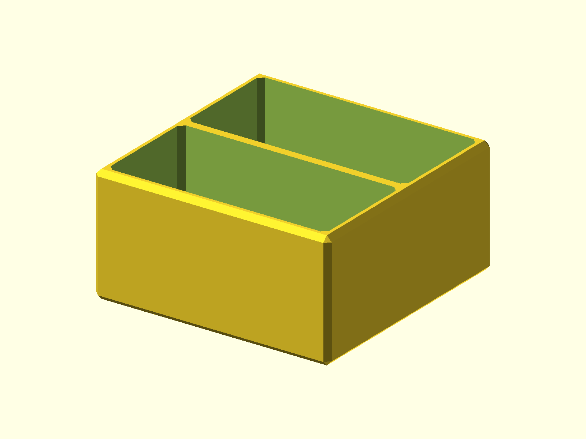

# Drawer / Cabinet Organizer

A chamfered, open-top organizer tray for drawers and cabinets. The outer
footprint is 70 x 70 x 35 mm; `divisions` sets the number of internal
compartments from 1 to 4.

Published on [Printables](https://www.printables.com/model/314660-drawer-cabinet-organizer).



## Status

- Last verified: 2026-10-21 (build)
- OpenSCAD version: see the [root README](../../README.md)
- Physically tested on: Original Prusa MK3.5S

## Files

| File | Purpose |
|---|---|
| `tray_organizer.scad` | canonical source |
| `render.json` | primary variant and declared variants |

## Variants

| Variant | Image | Difference |
|---|---|---|
| primary | `img/primary/` | 2 compartments (default) |
| `div1` | `img/div1/` | 1 compartment |
| `div3` | `img/div3/` | 3 compartments |
| `div4` | `img/div4/` | 4 compartments |

The outer dimensions stay 70 x 70 x 35 mm for every variant.

## Hardware

None.

## Printing

Print flat on the base. No supports are modeled; the chamfered outer walls are
self-supporting. Check the divider height in your slicer before printing.

## Build

```bash
python scripts/check_models.py --model drawer-cabinet-organizer
python scripts/render_previews.py models/drawer-cabinet-organizer --all
```

Or directly:

```bash
openscad --hardwarnings -D divisions=2 -o build/tray_organizer.stl tray_organizer.scad
```

## Known issues

None recorded.

## License

CC BY 4.0 — WolfOne (@wolfone_17684). See the repository [LICENSE](../../LICENSE).
