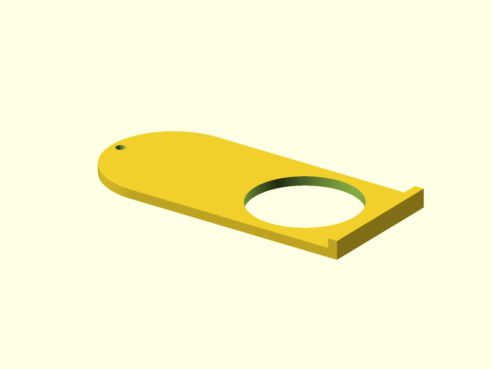

# Dust Extractor Valve

Parameterized blast-gate valve and slider for a dust extractor. The source
contains both printable parts and tube-connector options.



## Status

- Last verified: 2026-10-22 (build)
- OpenSCAD version: see the [root README](../../README.md)

## Files

| File | Purpose |
|---|---|
| `dust_extractor_valve_and_slider.scad` | valve, slider, and tube connectors |
| `render.json` | primary slider and valve variant |

## Variants

| Variant | Image | Content |
|---|---|---|
| primary | `img/primary/` | slider |
| `valve` | `img/valve/` | valve body |

## Options

```bash
-D 'part="Slider"'  # slider (default)
-D 'part="Valve"'   # valve body
```

Tube sizes and connector modes are set near the top of the source:
`tube_outer_diameter`, `tube_inner_diameter`, `connector_top_mode`, and
`connector_bottom_mode`.

## Dimensions

| Part | Size |
|---|---|
| Valve body | 75 x 85 x 20 mm |
| Valve, default connectors | 75 mm overall height (30 mm top, 25 mm bottom) |
| Slider | 151.1 x 69.7 mm, 9.6 mm overall (4.7 mm body plate) |

Default tube: 62.5 mm OD / 56.1 mm ID. Connector modes: 0 female (72.5
OD / 62.5 ID), 1 male OD (62.5 OD / 56.1 ID), 2 male ID (56.1 OD / 49.7
ID). The valve's side opening is 70 x 5 mm; the slider is 0.3 mm smaller
each way so it slides freely. A 5 x 5 mm end-stop tab on the slider stops
it sliding through the valve.

## Hardware

None. The slider is held by friction in the opening; a pin or nail
through the 5 mm hole at its rounded end acts as the end stop.

## Material

PETG.

## Printing

Print the slider and valve flat as oriented. No supports are modeled.

## Build

```bash
python scripts/check_models.py --model dust-extractor-valve
python scripts/render_previews.py models/dust-extractor-valve --all
```

## Known issues

- Not yet published on Printables.

## License

CC BY 4.0 — WolfOne (@wolfone_17684). See the repository [LICENSE](../../LICENSE).
