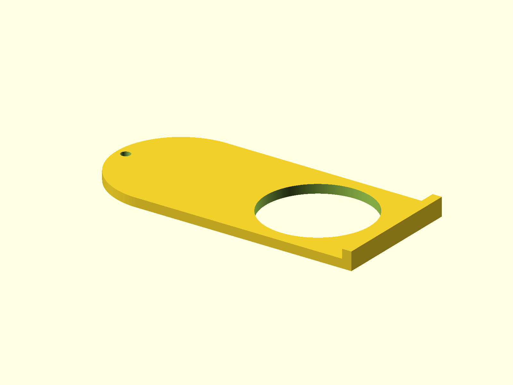

# Dust Extractor Valve

Parameterized blast-gate valve and slider for a dust extractor. The source
contains both printable parts and tube-connector options.



## Status

- Last verified: 2026-10-22 (build)
- OpenSCAD version: see the [root README](../../README.md)

## Files

| File | Purpose |
|---|---|
| `dust_extractor_valve_and_slider.scad` | valve, slider, and tube connectors |
| `render.json` | primary slider and valve variant |

## Variants

| Variant | Image | Content |
|---|---|---|
| primary | `img/primary/` | slider |
| `valve` | `img/valve/` | valve body |

## Options

```bash
-D 'part="Slider"'  # slider (default)
-D 'part="Valve"'   # valve body
```

Tube sizes and connector modes are set near the top of the source:
`tube_outer_diameter`, `tube_inner_diameter`, `connector_top_mode`, and
`connector_bottom_mode`.

## Printing

Print the slider and valve flat as oriented. No supports are modeled.

## Build

```bash
python scripts/check_models.py --model dust-extractor-valve
python scripts/render_previews.py models/dust-extractor-valve --all
```

Or directly:

```bash
openscad --hardwarnings -D 'part="Valve"' -o build/dust_valve.stl dust_extractor_valve_and_slider.scad
```

## Known issues

- Not yet published on Printables.

## License

CC BY 4.0 — WolfOne (@wolfone_17684). See the repository [LICENSE](../../LICENSE).
