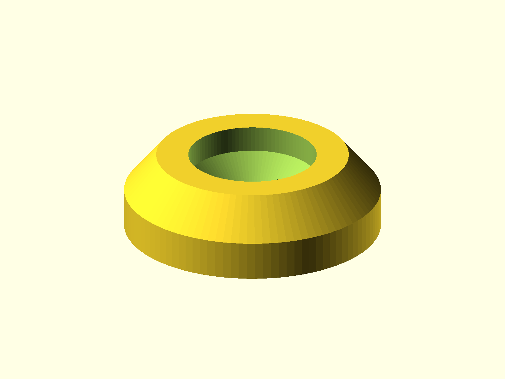

# Furniture Foot

Tapered round foot with a center recess, intended as a replaceable furniture or
equipment foot.



## Status

- Last verified: 2026-10-22 (build)
- OpenSCAD version: see the [root README](../../README.md)
- Physically tested: yes (printer/date not recorded)

## Files

| File | Purpose |
|---|---|
| `furniture_foot.scad` | tapered foot |
| `render.json` | primary entry point |

## Dimensions

- Base diameter: 20 mm.
- Top diameter: 15 mm.
- Height: 6 mm.
- Center recess for a screw head.

The model can be scaled for different hardware and furniture sizes.

## Material

TPU or a similar rubbery material.

## Printing

Print as oriented. No supports are modeled.

## Build

```bash
python scripts/check_models.py --model furniture-foot
python scripts/render_previews.py models/furniture-foot
```

Or directly:

```bash
openscad --hardwarnings -o build/furniture_foot.stl furniture_foot.scad
```

## Known issues

- Not yet published on Printables.

## License

CC BY 4.0 — WolfOne (@wolfone_17684). See the repository [LICENSE](../../LICENSE).
