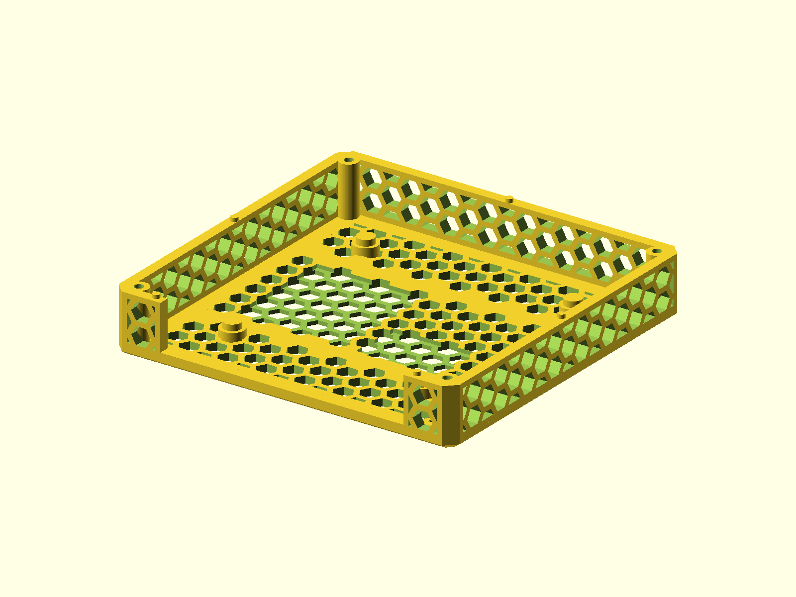

# Netgear LM1200 Shell

A vented enclosure for the Netgear LM1200 LTE modem, derived from the NRadio
C2000 enclosure for modem airflow and mounting in a Belabox IRL backpack. The
body and lid are separate print parts; the `full` variant previews them
together.

Published on [Printables](https://www.printables.com/model/771215-netgear-lm1200-caseshell).



## Status

- Last verified: 2026-10-21 (build)
- OpenSCAD version: see the [root README](../../README.md)
- Physically tested on: Original Prusa MK3.5S

## Files

| File | Purpose |
|---|---|
| `lm1200_enclosure.scad` | body, lid, and full assembly |
| `render.json` | primary variant and declared variants |

## Variants

| Variant | Image | Dimensions | Part |
|---|---|---|---|
| primary (`body`) | `img/primary/` | 115 x 112 x 20.6 mm | body only |
| `lid` | `img/lid/` | 115 x 112 x 10.0 mm | lid only |
| `full` | `img/full/` | 115 x 112 x 29.6 mm | body + lid |

Select a part with `-D part="body"`, `-D part="lid"`, or `-D part="full"`.

## Hardware

| Item | Qty | Notes |
|---|---|---|
| M3 screw | 4 | Lid; length not stated |
| M3x15 screw | 4 | Optional 30 mm fan |

The modem board is press-fit and uses the existing modem mounting points.

## Material

PETG.

## Printing

Print the body and lid flat as oriented. No supports are modeled.

## Build

```bash
python scripts/check_models.py --model netgear-lm1200-shell
python scripts/render_previews.py models/netgear-lm1200-shell --all
```

Or directly:

```bash
openscad --hardwarnings -D part="body" -o build/lm1200_body.stl lm1200_enclosure.scad
openscad --hardwarnings -D part="lid" -o build/lm1200_lid.stl lm1200_enclosure.scad
```

## Known issues

None recorded.

## License

CC BY 4.0 — WolfOne (@wolfone_17684). See the repository [LICENSE](../../LICENSE).
