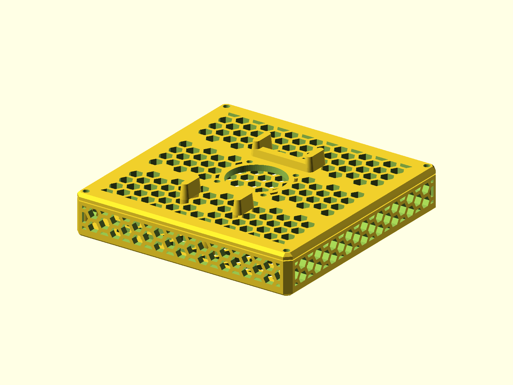

# NRadio C2000 Shell

A vented enclosure for the NRadio C2000 LTE modem. The current layout is the
only published source; fan and modem openings are selectable options.

Published on [Printables](https://www.printables.com/model/665497-nradio-c2000-case-shell).



## Status

- Last verified: 2026-10-22 (build)
- OpenSCAD version: see the [root README](../../README.md)
- Physically tested on: Original Prusa MK3.5S

## Files

| File | Purpose |
|---|---|
| `nradio_enclosure.scad` | body, lid, and option flags |
| `render.json` | primary variant and declared variants |

## Variants

| Variant | Image | Dimensions | Options |
|---|---|---|---|
| primary (`full`) | `img/primary/` | 114 x 114 x 27.5 mm | body + lid, fan mount, modem interfaces |
| `fanonly` | `img/fanonly/` | 114 x 114 x 3.0 mm | lid only, fan mount, no modem interfaces |
| `nofan` | `img/nofan/` | 114 x 114 x 27.5 mm | body + lid, no fan mount/cutout, modem interfaces |

Select parts and options with:

```bash
-D part="full"     # body + lid (default)
-D part="body"     # body only
-D part="lid"      # lid only
-D fan=false       # remove the fan mount/cutout
-D modem=false     # remove the modem interfaces
```

`fanonly` is `part="lid" modem=false`; `nofan` is `fan=false`.

## Hardware

No fasteners are included. The model uses the existing modem mounting points.

## Printing

Print the body and lid flat as oriented. No supports are modeled.

## Build

```bash
python scripts/check_models.py --model nradio-c2000-shell
python scripts/render_previews.py models/nradio-c2000-shell --all
```

Or directly:

```bash
openscad --hardwarnings -o build/nradio_full.stl nradio_enclosure.scad
openscad --hardwarnings -D part="lid" -D modem=false -o build/nradio_fanonly.stl nradio_enclosure.scad
openscad --hardwarnings -D fan=false -o build/nradio_nofan.stl nradio_enclosure.scad
```

## Known issues

None recorded.

## License

CC BY 4.0 — WolfOne (@wolfone_17684). See the repository [LICENSE](../../LICENSE).
