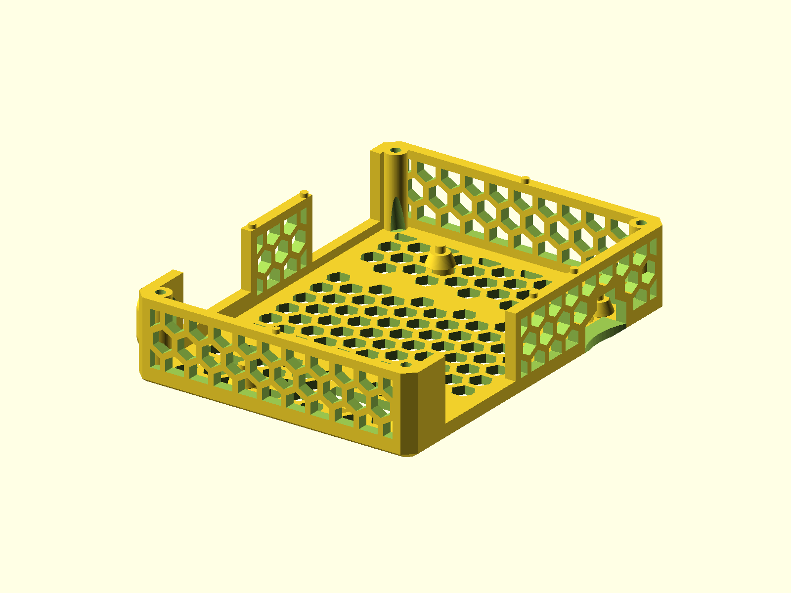

# Orange Pi 5 Plus Case

Two source versions of a vented Orange Pi 5 Plus enclosure. `v3` is the newer
revision; `v2` is kept for the earlier fit.

Published on Printables: [v3](https://www.printables.com/model/1078542-orange-pi-5-plus-case-v3),
[v2](https://www.printables.com/model/771222-orange-pi-5-plus-case-v2).



## Status

- Last verified: 2026-10-22 (build)
- OpenSCAD version: see the [root README](../../README.md)
- Physically tested on: not recorded

## Files

| File | Purpose |
|---|---|
| `orange_pi_enclosure_v3.scad` | newer body/lid, NVMe option |
| `orange_pi_enclosure_v2.scad` | earlier body/lid |
| `render.json` | primary and declared variants |

## Variants

| Variant | Image | Dimensions | Part |
|---|---|---|---|
| primary (`v3`) | `img/primary/` | 89.7 x 114.4 x 25.2 mm | v3 body |
| `v2` | `img/v2/` | 86.4 x 114.4 x 25.2 mm | v2 body |
| `v3_top` | `img/v3_top/` | 86.4 x 114.4 x 7.5 mm | v3 lid, fan mount |
| `v2_top` | `img/v2_top/` | 86.4 x 114.4 x 7.5 mm | v2 lid, fan mount |

The lid is shown with the fan mount. Without it the lid is 5.2 mm tall.

## Hardware

| Item | Qty | Notes |
|---|---|---|
| Flat M3 screw | 4 | v2 lid |
| Flat M3 screw | 5 or 6 | v3 lid |
| 5 V 3007 fan | 1 | Optional; press-fit in the lid fan mount |

The board is press-fit. `v3` may need light cleanup depending on the printer.

## Material

PETG.

## Options

```bash
-D part="body"          # body only (default)
-D part="top"           # lid only
-D part="full"          # body + lid
-D fanMount=0           # omit the lid fan mount
-D usbcSupport=0        # v2 default; v3 default is 1
-D nvme=1               # v3 only; add NVMe cutout
```

`v2` defaults to `part="body" usbcSupport=0`.
`v3` defaults to `part="body" usbcSupport=1 nvme=0`.

## Printing

Print the body and lid flat as oriented. The lid fan mount is for the original
fan opening; no supports are modeled.

## Build

```bash
python scripts/check_models.py --model orange-pi-5-plus-case
python scripts/render_previews.py models/orange-pi-5-plus-case --all
```

Or directly:

```bash
openscad --hardwarnings -o build/opi_v3_body.stl orange_pi_enclosure_v3.scad
openscad --hardwarnings -D part="top" -o build/opi_v3_top.stl orange_pi_enclosure_v3.scad
openscad --hardwarnings -D part="full" -o build/opi_v3_full.stl orange_pi_enclosure_v3.scad
openscad --hardwarnings -D part="top" -o build/opi_v2_top.stl orange_pi_enclosure_v2.scad
```

## Known issues

- `v3` adds a separate NVMe cutout option; it is off by default.

## License

CC BY 4.0 — WolfOne (@wolfone_17684). See the repository [LICENSE](../../LICENSE).
