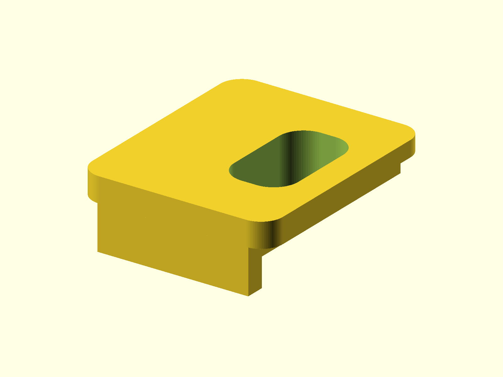

# Osmo Action 4 USB-C Cable Support

A replacement door and cable support for the DJI Osmo Action 4 USB-C port. The
door captures the cable and reduces strain on the camera's USB-C connector.

Published on [Printables](https://www.printables.com/model/617365-osmo-action-4-usb-c-cable-support).



## Status

- Last verified: 2026-10-21 (build)
- OpenSCAD version: see the [root README](../../README.md)
- Designed for: DJI Osmo Action 4
- Physically tested on: Original Prusa MK3.5S

## Files

| File | Purpose |
|---|---|
| `OA4_USBC_Door.scad` | canonical source |
| `render.json` | primary variant and declared variants |

## Variants

| Variant | Image | Overall height | Difference |
|---|---|---|---|
| primary | `img/primary/` | 7.0 mm | standard cable support (default) |
| `medium` | `img/medium/` | 9.0 mm | taller cable support |
| `large` | `img/large/` | 11.0 mm | tallest cable support |

All variants share the same 19.3 x 22.9 mm footprint.

## Hardware

None.

## Printing

Print as oriented. Check the latch and top overhangs in your slicer; support
requirements depend on the printer and material. No printer profiles or
machine-specific settings are published.

## Build

```bash
python scripts/check_models.py --model osmo-action-4-cable-support
python scripts/render_previews.py models/osmo-action-4-cable-support --all
```

Or directly:

```bash
openscad --hardwarnings -D large=0 -o build/OA4_USBC_Door.stl OA4_USBC_Door.scad
```

## Known issues

None recorded.

## License

CC BY 4.0 — WolfOne (@wolfone_17684). See the repository [LICENSE](../../LICENSE).
