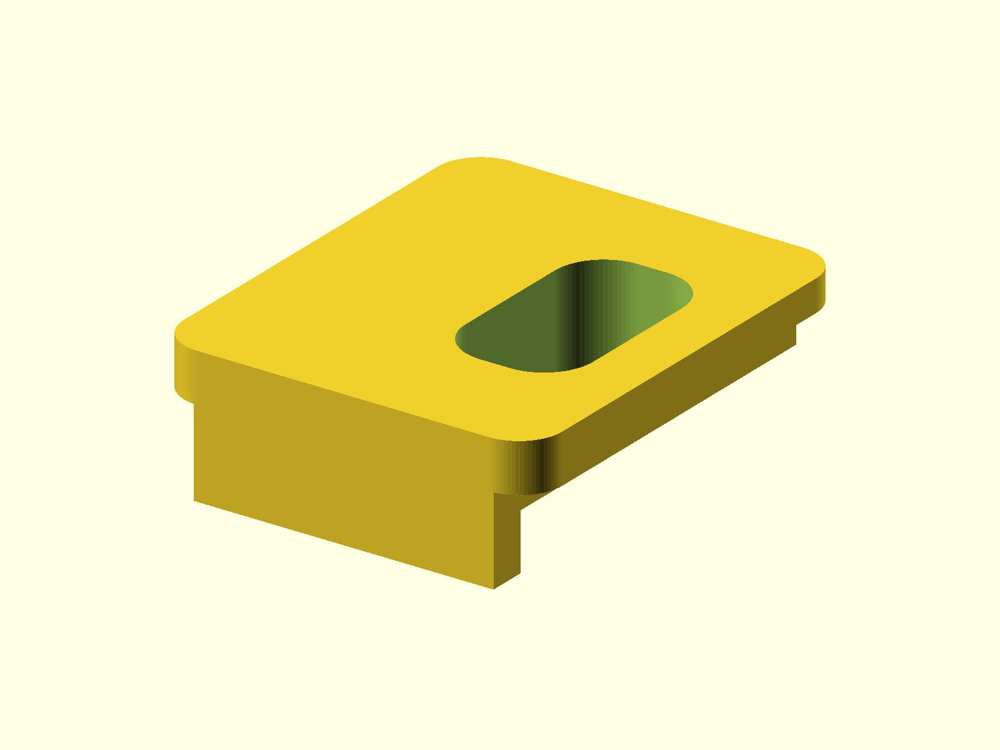

# USB-C Cable Support for the DJI Osmo Action 4

A replacement door and cable support for the DJI Osmo Action 4 USB-C port. The
door captures the cable and reduces strain on the camera's USB-C connector.

Published on [Printables](https://www.printables.com/model/617365-osmo-action-4-usb-c-cable-support).



## Status

- Last verified: 2026-10-21 (build)
- OpenSCAD version: see the [root README](../../README.md)
- Designed for: DJI Osmo Action 4
- Compatibility: Action 5 is untested; it may fit based on published photos.
- Physically tested on: Original Prusa MK3.5S

## Files

| File | Purpose |
|---|---|
| `OA4_USBC_Door.scad` | canonical source |
| `render.json` | primary variant and declared variants |

## Variants

| Variant | Image | Overall height | Difference |
|---|---|---|---|
| primary | `img/primary/` | 7.0 mm | standard cable support (default) |
| `medium` | `img/medium/` | 9.0 mm | taller cable support |
| `large` | `img/large/` | 11.0 mm | tallest cable support |

All variants share the same 19.3 x 22.9 mm footprint.

## Dimensions

- Top plate (shared by all variants): 19.3 x 22.9 mm.
- Overall height: 7.0 mm standard, 9.0 mm medium, 11.0 mm large.
- USB-C opening through the door: 6.5 x 11.5 mm.

## Hardware

None.

## Installation

The door snaps into the camera's USB-C port recess; the latch at
the front edge holds it in place. Once installed, the door
captures the cable and reduces strain on the connector.

## Material

Test prints were made in PLA. PETG or another heat-tolerant material is
recommended for use on the camera.

## Printing

Print as oriented. Check the latch and top overhangs in your slicer; support
requirements depend on the printer and material. No printer profiles or
machine-specific settings are published.

## Build

```bash
python scripts/check_models.py --model osmo-action-4-cable-support
python scripts/render_previews.py models/osmo-action-4-cable-support --all
```

## Known issues

- The door can be difficult to remove; a dental tool was needed on one
  revision. Test-fit before relying on it.
- Action 5 compatibility is not tested.

## License

CC BY 4.0 — WolfOne (@wolfone_17684). See the repository [LICENSE](../../LICENSE).
