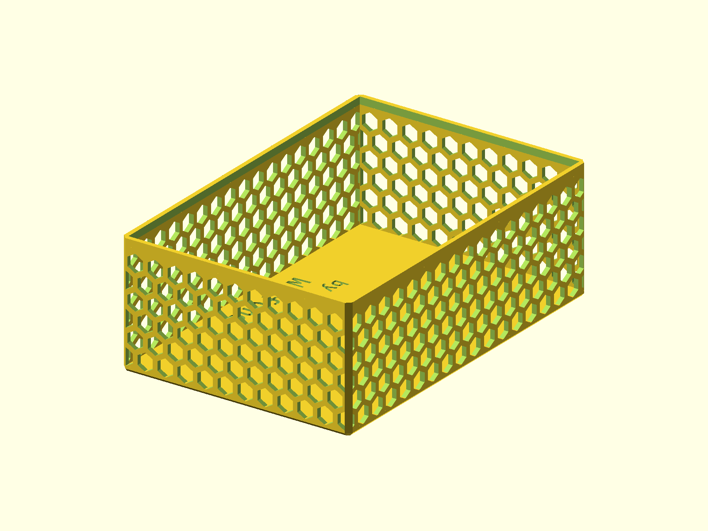

# Parametric Box

A hexagonal-wall storage box with two profiles. The elongated profile is the
default; the square profile is the same model in a shorter, wider body.



## Status

- Last verified: 2026-10-21 (build)
- OpenSCAD version: see the [root README](../../README.md)
- Physically tested on: Original Prusa MK3.5S

## Files

| File | Purpose |
|---|---|
| `parametric_box.scad` | canonical source |
| `render.json` | primary variant and declared variants |

## Variants

| Variant | Image | Dimensions | Difference |
|---|---|---|---|
| primary | `img/primary/` | 96.6 x 143.5 x 51 mm | elongated body (default) |
| `square` | `img/square/` | 96.6 x 96.6 x 52 mm | square body |

Select a variant with `-D variant="elongated"` or `-D variant="square"`.

## Hardware

None. The body has a lid seat; a separate lid is not included in this source.

## Printing

Print flat on the base. The hexagonal wall openings are vertical; no supports
are modeled.

## Build

```bash
python scripts/check_models.py --model parametric-box
python scripts/render_previews.py models/parametric-box --all
```

Or directly:

```bash
openscad --hardwarnings -D variant="elongated" -o build/parametric_box.stl parametric_box.scad
```

## Known issues

None recorded.

## License

CC BY 4.0 — WolfOne (@wolfone_17684). See the repository [LICENSE](../../LICENSE).
