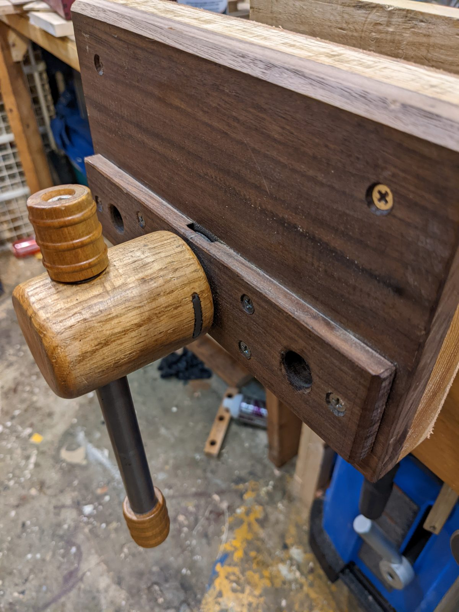
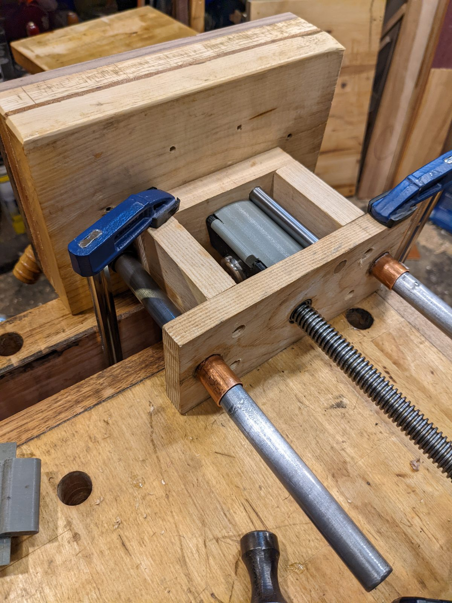
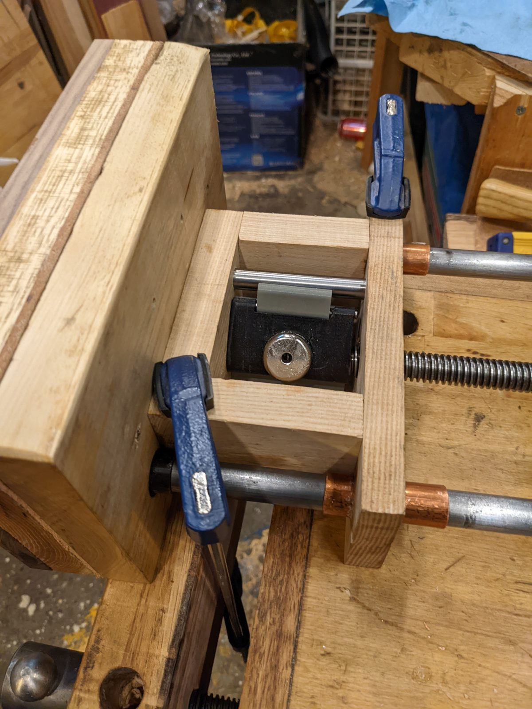
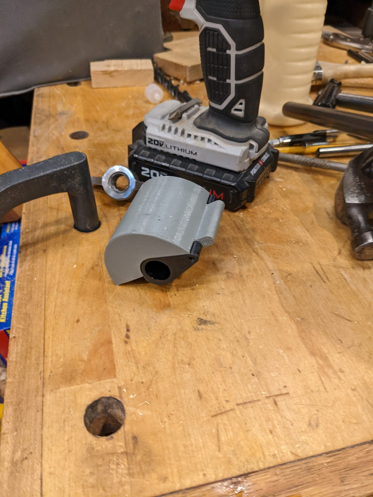

# QR Vise

Magnetic quick-release vise for a 5/8 in threaded rod, with a 1 in magnet and
an 8 mm pin. The source is a single OpenSCAD file with separate body and latch
views.


## Photos









## Status

- Last verified: 2026-10-24 (build)
- OpenSCAD version: see the [root README](../../README.md)
- Physically tested on: builder's bench; mechanism shown installed (2026-10-24)

## Files

| File | Purpose |
|---|---|
| `qr_vise.scad` | body, latch, and visual assembly |
| `render.json` | primary and component views |

## Variants

| Variant | Image | Content |
|---|---|---|
| primary | `img/primary/` | full assembly |
| `body` | `img/body/` | vise body |
| `latch` | `img/latch/` | latch |

The `full` view includes non-printed visual indicators such as the pin. Use the
`body` and `latch` views for the printed parts.

## Options

```bash
-D 'display="full"'      # assembly
-D 'display="body"'      # body only
-D 'display="latch"'     # latch only
-D 'display="accessory"' # non-printed accessory indicators
```

Hardware dimensions are set in the source: `threadedRod` for the 5/8 rod,
`hexNutWidth`/`hexNutLength` for the half-nut interface, and `latchRadius` for
the latch fit.

## Mechanism

The printed body and latch are only part of the assembly. The locking mechanism
also needs:

- A strong magnet.
- A large steel pin, carefully positioned so the mechanism can lock.
- A small loose pin or nail joining the two mechanism parts.
- A half nut, made to fit the threaded rod and glued into the housing.

Turning the vise to the right lets the magnet pull the mechanism toward the
pin. That forces the half nut to lock, and friction holds the clamping pressure.
Turning to the left makes the small pawl that sticks out hit the pin and
disengage the half nut, so the jaws slide freely.

The parts are assembled into a four-sided wooden box. The builder used 3/4 in
hickory or similar hardwood; plywood also works and is what the original box was
made from.

## Printing

Print the body and latch in the orientation shown. The design uses the body and
latch as separate printed parts; the accessory view is for visualization only.
The wooden box, steel pin, magnet, loose pin/nail, and half nut are non-printed
parts.

## Build

```bash
python scripts/check_models.py --model qr-vise
python scripts/render_previews.py models/qr-vise --all
```

Or directly:

```bash
openscad --hardwarnings -D 'display="body"' -o build/qr_vise_body.stl qr_vise.scad
```

## Known issues

- Not yet published on Printables.
- The wooden box dimensions are not parameterized; make the box to fit the
  bench and the 5/8 in rod.

## License

CC BY 4.0 — WolfOne (@wolfone_17684). See the repository [LICENSE](../../LICENSE).
