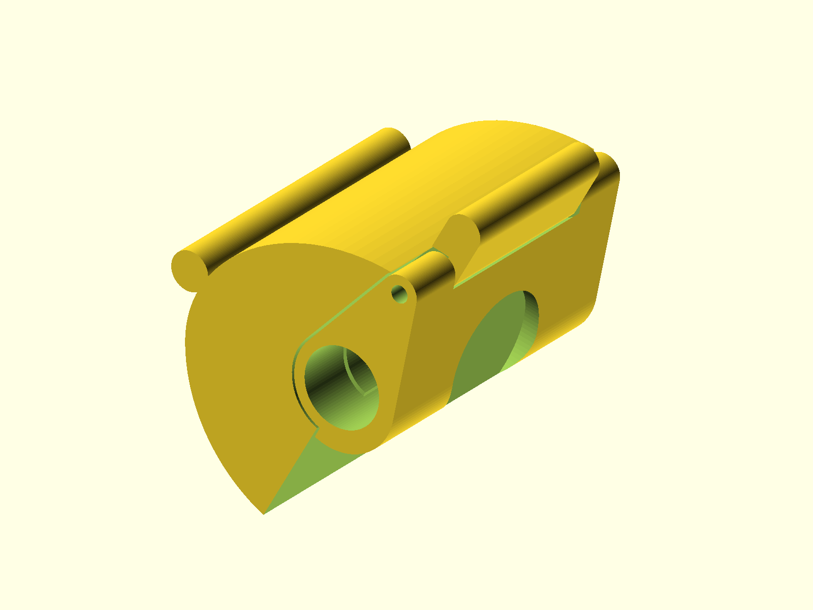

# QR Vise

Magnetic quick-release vise for a 5/8 in threaded rod, with a 1 in magnet and
an 8 mm pin. The source is a single OpenSCAD file with separate body and latch
views.



## Status

- Last verified: 2026-10-22 (build)
- OpenSCAD version: see the [root README](../../README.md)
- Physically tested on: not recorded

## Files

| File | Purpose |
|---|---|
| `qr_vise.scad` | body, latch, and visual assembly |
| `render.json` | primary and component views |

## Variants

| Variant | Image | Content |
|---|---|---|
| primary | `img/primary/` | full assembly |
| `body` | `img/body/` | vise body |
| `latch` | `img/latch/` | latch |

The `full` view includes non-printed visual indicators such as the pin. Use the
`body` and `latch` views for the printed parts.

## Options

```bash
-D 'display="full"'      # assembly
-D 'display="body"'      # body only
-D 'display="latch"'     # latch only
-D 'display="accessory"' # non-printed accessory indicators
```

Hardware dimensions are set in the source: `threadedRod` for the 5/8 rod,
`hexNutWidth`/`hexNutLength` for the half-nut interface, and `latchRadius` for
the latch fit.

## Printing

Print the body and latch in the orientation shown. The design uses the body and
latch as separate printed parts; the accessory view is for visualization only.

## Build

```bash
python scripts/check_models.py --model qr-vise
python scripts/render_previews.py models/qr-vise --all
```

Or directly:

```bash
openscad --hardwarnings -D 'display="body"' -o build/qr_vise_body.stl qr_vise.scad
```

## Known issues

- Printables model URL is not recorded in this README yet.
- Physical-test status is not recorded.

## License

CC BY 4.0 — WolfOne (@wolfone_17684). See the repository [LICENSE](../../LICENSE).
