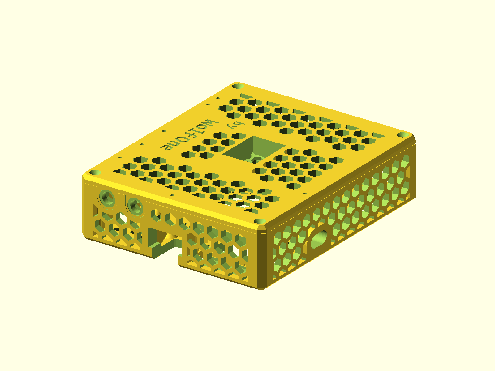

# Radxa Rock 5B+ Case

Vented enclosure for the Radxa Rock 5B+ with optional top antenna mounts,
modem mounting, and 25 mm or 30 mm fan layouts.

Printables profile: [wolfone_17684](https://www.printables.com/@wolfone_17684).



## Status

- Last verified: 2026-10-22 (build)
- OpenSCAD version: see the [root README](../../README.md)
- Physically tested on: not recorded

## Files

| File | Purpose |
|---|---|
| `rock5bplus_model.scad` | standalone body, lid, and feature options |
| `render.json` | primary and declared feature variants |

## Variants

| Variant | Image | Feature |
|---|---|---|
| primary | `img/primary/` | 30 mm fans, 2 SMA, modem |
| `sma0` | `img/sma0/` | 30 mm fans, 0 SMA, modem |
| `sma4` | `img/sma4/` | 30 mm fans, 4 SMA, modem |
| `modem_off` | `img/modem_off/` | 30 mm fans, 2 SMA, no modem |
| `fan25` | `img/fan25/` | 25 mm fans, 2 SMA, modem |
| `lessfans` | `img/lessfans/` | reduced fan cutouts |
| `shrink` | `img/shrink/` | no top fan space |

`render.json` selects `sma=2 modemMount=1 fan_25mm=0` for the primary preview.
The source defaults remain `sma=0 modemMount=0`, matching the public source.

## Options

```bash
-D sma=0|2|4          # top antenna mounts
-D modemMount=0|1     # upper modem mount
-D fan_25mm=0|1       # 30 mm or 25 mm fan space
-D less_fans=0|1      # reduce fan cutouts
-D shrink=0|1         # remove top fan space
-D body=0|1           # show body
-D lid=0|1            # show lid
-D pcb=0|1            # show PCB reference
```

## Printing

Print the body and lid flat as oriented. The model is designed for a 210 x 250
mm bed. No supports are modeled.

## Build

```bash
python scripts/check_models.py --model radxa-rock-5b-plus-case
python scripts/render_previews.py models/radxa-rock-5b-plus-case --all
```

Or directly:

```bash
openscad --hardwarnings -D sma=2 -D modemMount=1 -o build/rock5b.stl rock5bplus_model.scad
```

## Known issues

- Printables model URL is not recorded in this README yet.
- Physical-test status is not recorded.
- The branding text uses `Consolas:Bold`; override the font in OpenSCAD if it
  is unavailable on the host.

## License

CC BY 4.0 — WolfOne (@wolfone_17684). See the repository [LICENSE](../../LICENSE).
