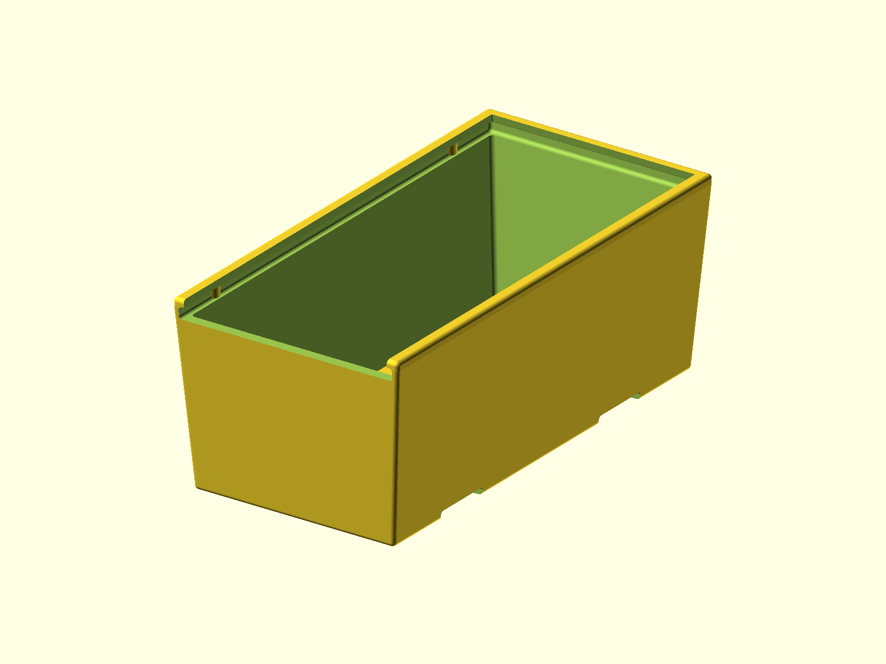

# Stackable Box

A stackable box with a sliding lid. The main body is 45 x 90 x 35 mm. A smaller
thread-tap insert is included as an optional variation.



## Status

- Last verified: 2026-10-21 (build)
- OpenSCAD version: see the [root README](../../README.md)
- Physically tested on: Original Prusa MK3.5S

## Files

| File | Purpose |
|---|---|
| `stackable_box.scad` | main stackable box |
| `thread_tap_box.scad` | optional smaller thread-tap box |
| `render.json` | primary variant and declared variants |

## Variants

| Variant | Image | Dimensions | Difference |
|---|---|---|---|
| primary | `img/primary/` | 45 x 90 x 35 mm | stackable box (default) |
| `thread_tap` | `img/thread_tap/` | 40 x 80 x 16.6 mm | smaller interlock box for thread-tapping tools |

`stackable_box.scad` also exposes `display` (`box`, `lid`, `interlock`, `full`)
and `divisions` (0-4) for custom builds. The declared variants above are the
ones published here.

## Hardware

None.

## Printing

Print as oriented. Check the sliding-lid and interlock clearances in your slicer;
they depend on the printer and material.

## Build

```bash
python scripts/check_models.py --model stackable-box
python scripts/render_previews.py models/stackable-box --all
```

Or directly:

```bash
openscad --hardwarnings -o build/stackable_box.stl stackable_box.scad
openscad --hardwarnings -o build/thread_tap_box.stl thread_tap_box.scad
```

## Known issues

None recorded.

## License

CC BY 4.0 — WolfOne (@wolfone_17684). See the repository [LICENSE](../../LICENSE).
