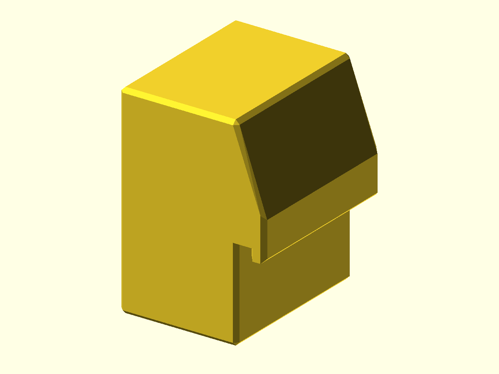

# Thermaltake P3 Vertical GPU Foot

Custom support foot for a vertically mounted graphics card in a Thermaltake P3
base or Core. It is a measured, card-specific fit rather than a universal
drop-in.



## Status

- Last verified: 2026-10-22 (build)
- OpenSCAD version: see the [root README](../../README.md)
- Physically tested on: Original Prusa MK3.5S

## Files

| File | Purpose |
|---|---|
| `thermaltake_p3_gpu_foot.scad` | vertical GPU support foot |
| `render.json` | primary entry point |

## Dimensions

- 18.5 x 21 x 26 mm.
- Support face: 20 x 3 mm; the lip sits 22.5–25.5 mm above the bottom.

## Fit and retention

- A ledge hooks over a lip in the case's metal base bracket. The foot is not
  permanently fixed.
- Height is custom for each GPU and case; measure the needed height for a level
  mount and support at the intended contact point.
- The contact point varies by card; the author's foot contacts the GPU shroud.
- No screw holes are modeled; retention is by the ledge and base bracket.

## Hardware

None. The foot is retained by the ledge over the case base bracket and is not
permanently fixed.

## Material

PLA was used for the author's fit. Use PETG or a stronger, more heat-resistant
material depending on where the foot contacts the card and how much heat that
area sees.

## Printing

Print as oriented. No supports are modeled.

## Build

```bash
python scripts/check_models.py --model thermaltake-p3-gpu-foot
python scripts/render_previews.py models/thermaltake-p3-gpu-foot
```

Or directly:

```bash
openscad --hardwarnings -o build/thermaltake_p3_gpu_foot.stl thermaltake_p3_gpu_foot.scad
```

## Known issues

- Not yet published on Printables.
- The exact P3 base/Core variant is not confirmed.
- The source has no case- or card-specific parameters; the fit is custom and
  must be measured for the intended GPU and case.

## License

CC BY 4.0 — WolfOne (@wolfone_17684). See the repository [LICENSE](../../LICENSE).
