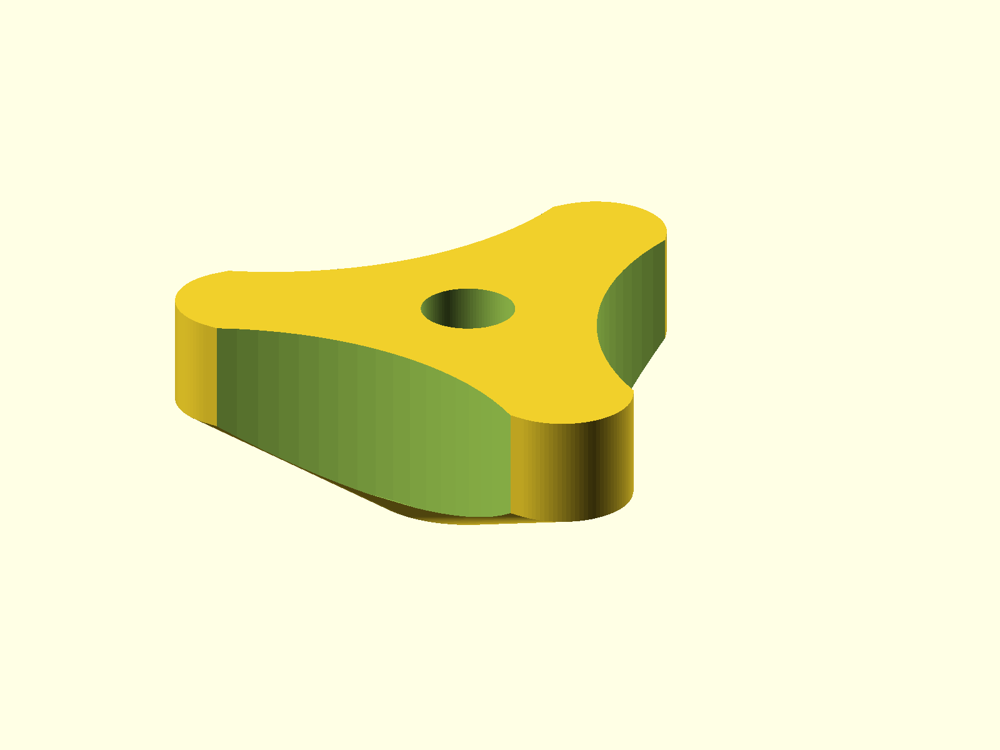

# Tri-Wing Nut

Tri-wing clamping nut for the CNC machine. It uses an embedded 1/4 in nut and a
through-bolt.



## Status

- Last verified: 2026-10-22 (build)
- OpenSCAD version: see the [root README](../../README.md)
- Physically tested on: not recorded

## Design notes

- Designed for 1/4 in hardware with a press-fit hex nut.
- The top through-hole is 7.0 mm diameter (3.5 mm radius), 0.5 mm larger than
  the original 6.5 mm bore, so it clears the 1/4 in bolt instead of interfering
  with it.
- The nut pocket uses a 11.1125 mm hex width.

## Printing

Print flat as oriented. No supports are modeled.

## Build

```bash
python scripts/check_models.py --model tri-wing-nut
python scripts/render_previews.py models/tri-wing-nut
```

Or directly:

```bash
openscad --hardwarnings -o build/tri_wing_nut.stl tri_wing_nut.scad
```

## Known issues

- Not yet published on Printables.
- Physical-test status is not recorded.

## License

CC BY 4.0 — WolfOne (@wolfone_17684). See the repository [LICENSE](../../LICENSE).
