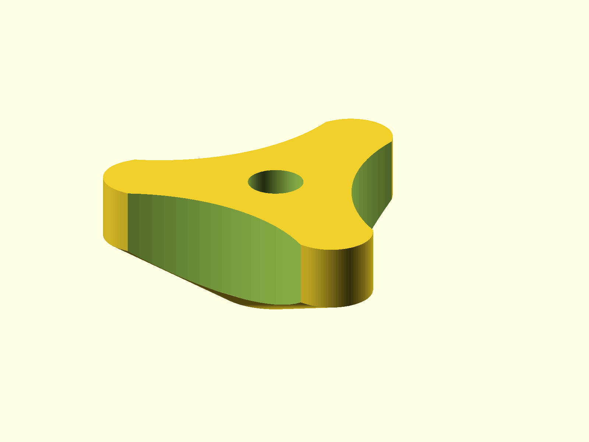

# Tri-Wing Nut

Tri-wing clamping nut for the CNC machine. It uses an embedded 1/4 in nut and a
through-bolt.



## Status

- Last verified: 2026-10-22 (build)
- OpenSCAD version: see the [root README](../../README.md)

## Design notes

- Designed for 1/4 in hardware with a press-fit hex nut.
- The top through-hole is 7.0 mm diameter (3.5 mm radius), 0.5 mm larger than
  the original 6.5 mm bore, so it clears the 1/4 in bolt instead of interfering
  with it.
- The nut pocket fits a 1/4 in hex nut (11.1 mm across flats).

## Dimensions

| Item | Size |
|---|---|
| Overall footprint | 39.1 x 35.2 mm |
| Overall height | 14 mm |
| Through bore | 7.0 mm dia |
| Hex pocket | 11.1 mm across flats (7/16 in), press-fit |

Three wings at 120 degrees; wing tips reach 21.75 mm from the center.

## Hardware

One 1/4 in hex nut press-fit into the pocket, plus a 1/4 in through-bolt
in the 7.0 mm bore. The source does not state a nut or bolt grade.

## Material

PLA. PETG is an option for higher-torque use of the 1/4 in hardware.

## Printing

Print flat as oriented. No supports are modeled.

## Build

```bash
python scripts/check_models.py --model tri-wing-nut
python scripts/render_previews.py models/tri-wing-nut --all
```

## Known issues

- Not yet published on Printables.

## License

CC BY 4.0 — WolfOne (@wolfone_17684). See the repository [LICENSE](../../LICENSE).
