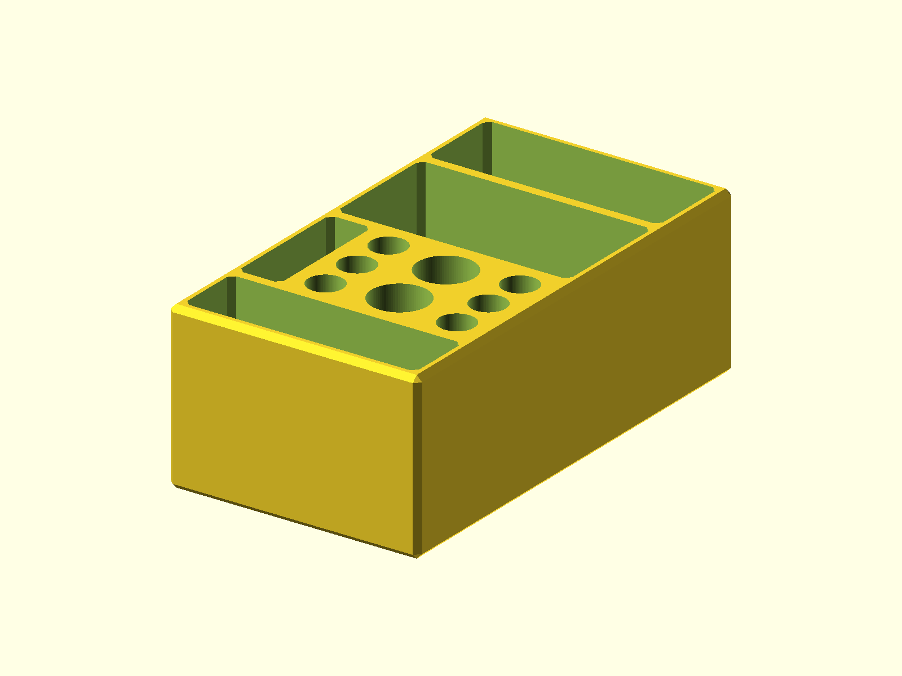

# TS80P Soldering Kit

A storage kit for a TS80/TS80P soldering iron, tips, solder, cable, and power
supply. The dual layout is the primary, actively used version.

Published on [Printables](https://www.printables.com/model/314754-ts80p-soldering-kit).



## Status

- Last verified: 2026-10-21 (build)
- OpenSCAD version: see the [root README](../../README.md)
- Physically tested on: Original Prusa MK3.5S

## Files

| File | Purpose |
|---|---|
| `soldering_kit.scad` | current kit; `type = "dual"` or `"single"` |
| `soldering_kit_legacy.scad` | older layout, kept as an optional variation |
| `render.json` | primary variant and declared variants |

## Variants

| Variant | Image | Dimensions | Difference |
|---|---|---|---|
| primary | `img/primary/` | 65 x 117 x 43 mm | 2 irons + 6 tips (default) |
| `single` | `img/single/` | 65 x 102 x 43 mm | 1 iron + 4 tips |
| `legacy` | `img/legacy/` | 65 x 118 x 43 mm | older opening layout |

The legacy file is kept separate because its body and opening layout differ
from the current parametric `type` paths.

## Hardware

None.

## Printing

Print flat on the base. The current source does not model supports.

## Build

```bash
python scripts/check_models.py --model ts80p-soldering-kit
python scripts/render_previews.py models/ts80p-soldering-kit --all
```

Or directly:

```bash
openscad --hardwarnings -D type="dual" -o build/soldering_kit.stl soldering_kit.scad
openscad --hardwarnings -o build/soldering_kit_legacy.stl soldering_kit_legacy.scad
```

## Known issues

None recorded.

## License

CC BY 4.0 — WolfOne (@wolfone_17684). See the repository [LICENSE](../../LICENSE).
