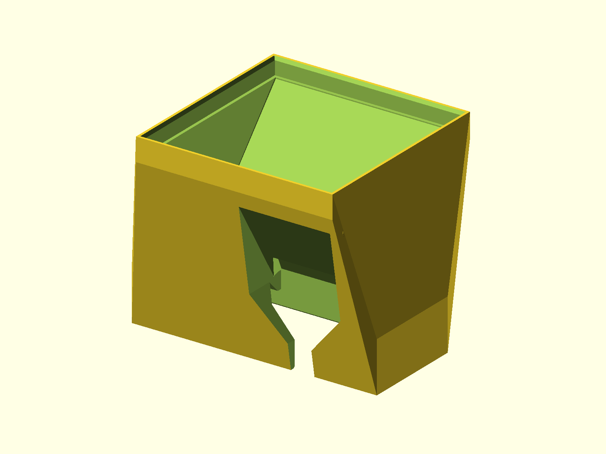

# Fan Shroud for the AMD Radeon PRO V620

Printed fan shroud for the passive AMD Radeon PRO V620. It replaces the
server-chassis airflow path with a standard axial fan, so the card can be used
in a normal desktop case without buying a third-party shroud.

The primary version uses one **80 mm fan**. A **single-slot version** uses two
40 mm fans. The model is shared free so users do not need to buy a printed
shroud.



## Status

- Last verified: 2026-10-25 (build)
- OpenSCAD version: see the [root README](../../README.md)
- Physically tested: yes, including the V620 fit and both 8-pin power plugs

## Compatibility

| Card | Fit |
|---|---|
| Radeon PRO V620 | Tested |
| Radeon PRO V340L | Confirmed to work; needs adjusted sizing (same heatsink opening) |
| Instinct MI50 / MI100 | May fit with tweaks; check the heatsink opening and screw bosses |

The shroud grips the stock heatsink opening by friction. It does not screw to
the card.

## Fans

| Version | Fan |
|---|---|
| Primary | 1× ARCTIC S8038-7K (80 mm) |
| Single-slot | 2× ARCTIC S4028-15K (40 mm) |

The ARCTIC S4028-6K was tested and is not recommended for the 40 mm version.
Use the S4028-15K.

For the 80 mm version, **45% fan load** is the default setting. Start there and
increase only if the card is still throttling.

## Variants

| Variant | Fan layout | Notes |
|---|---|---|
| primary | 1× 80 mm, 90° | Default version |
| `80mm_75` | 1× 80 mm, 75° | Shallower fan angle |
| `80mm_60` | 1× 80 mm, 60° | Shallower fan angle |
| `80mm_45` | 1× 80 mm, 45° | Lowest-profile 80 mm angle |
| `single_slot_40` | 2× 40 mm | Single-slot alternate, S4028-15K |

## Dimensions

| Item | Size |
|---|---|
| Primary (90°) | 104.0 x 83.5 x 79.0 mm (45° variant is tallest at 105.6 mm) |
| Card opening | about 99.3–99.5 x 38.4 mm, 18 mm deep |
| Airflow duct opening | about 91.5 x 38 mm (single-slot version: about 26 mm tall) |
| 8-pin power cutout | 38.7 x 11.5 mm, 14 mm deep |
| 80 mm fan opening | about 80 mm wide, 8 mm deep |
| 40 mm fan openings (single-slot) | about 40 x 80 mm each, 20 mm deep |

Other fan angles (75/60/45°) and the single-slot version have slightly
different overall sizes.

## Power connectors

The V620 has two 8-pin power connectors. The shroud has a cable relief around
the connector area; check both plugs and cable bends with the shroud installed.
Do not trap or side-load the power cables.

## Printing

Print in PETG or another filament that tolerates the card's exhaust
temperature. The shroud is a thin duct; use enough walls to keep it rigid.

- 80 mm version: rotate the model 180° so the slot faces down.
- 40 mm version: no rotation; fan face down.
- No supports are modeled.

The shroud is a friction fit over the card opening. Clean the opening and check
the fit before forcing it into place.

## Build

```bash
python scripts/check_models.py --model v620-fan-shroud
python scripts/render_previews.py models/v620-fan-shroud --all
```

## Known issues

- The MI50 and MI100 fits have not been physically tested.
- The V340L fit is confirmed to work, but the source here is dimensioned for
  the V620; a V340L build needs adjusted sizing.
- The 40 mm version requires the higher-speed S4028-15K; the S4028-6K is not
  recommended.

## License

CC BY 4.0 — WolfOne (@wolfone_17684). See the repository [LICENSE](../../LICENSE).
